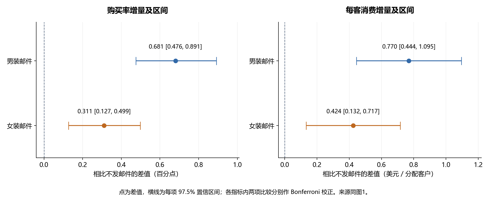

# Hillstrom 邮件营销 A/B 实验复盘

基于 **64,000 条客户记录**的公开三组随机实验，评估男装、女装内容邮件相比不发邮件，是否增加活动后两周的购买和每客消费。

## 问题与方法

按全部分配客户估计效果，保留未购买者的零金额，不按实验后访问筛选分母。主指标为购买率，辅助指标为每客消费；购买率差采用 Newcombe 区间与 score 检验，金额差采用 Welch 方法。每个指标内的两项对照比较使用 Bonferroni 校正，展示每项 97.5% 置信区间。两个指标合计四项结论未作为统一检验家族；邮件间直接比较为探索性。

## 主要成果

| 方案 | 分配人数 | 购买人数 | 两周购买率 | 每客消费（美元） |
|---|---:|---:|---:|---:|
| 不发邮件 | 21,306 | 122 | 0.573% | 0.653 |
| 男装内容邮件 | 21,307 | 267 | 1.253% | 1.423 |
| 女装内容邮件 | 21,387 | 189 | 0.884% | 1.077 |

男装与女装邮件相对不发邮件，购买率分别增加 **0.681、0.311 个百分点**，97.5% 区间分别为 [0.476, 0.891]、[0.127, 0.499] 个百分点；每客消费分别增加 **0.770、0.424 美元**，区间为 [0.444, 1.095]、[0.132, 0.717]。点估计支持优先复验男装内容，扩量还需成本、退款和客户负反馈。

产出数据质量与分组诊断、三组对账、增量估计、置信区间、两幅双面板图和完整报告。

## 查看成果

- [最终报告（可浏览）](report/report.md) · [完整 Word 报告](report/report.docx)
- [复现步骤与数据来源](docs/REPRODUCE.md) · [简历成果](docs/RESUME.md)
- [分组结果](data/analysis_output/report_group_summary.csv) · [增量与区间](data/analysis_output/report_effects.csv) · [归档指纹](docs/archive_manifest.json)



## 快速开始

使用 Python 3.13；从仓库根目录运行：

```powershell
python -m pip install -r requirements.txt
python python/verify_published_results.py
```

上述核验可直接使用仓库汇总数据。全量复现需从发布者获取 CSV，放入 `data/raw/`，再运行 `python python/03_build_report.py`。详细文件名、SHA-256 与图表字体配置见 [复现说明](docs/REPRODUCE.md)。新结果写入 `reproduction_output/`，保留归档最终版。

## 文件结构与限制

`python/` 统计与独立核验；`data/analysis_output/` 汇总 CSV；`report/` 最终报告；`figures/` 图表；`docs/` 复现、验证和简历材料。

来源：[Kevin Hillstrom / MineThatData 原始发布说明](https://blog.minethatdata.com/2008/03/minethatdata-e-mail-analytics-and-data.html)。数据许可尚未确认，原始 CSV 不再分发。全字段相同行缺少客户 ID 无法判定重复客户，主分析保留全部记录；缺少分流日志和精确实验日期，无法完整审计实验实施。最近购买间隔的异质性分析尚未完成；方案为回顾性分析，不是预注册或本人实施的线上实验，无法计算实际 ROI 或长期收益。
