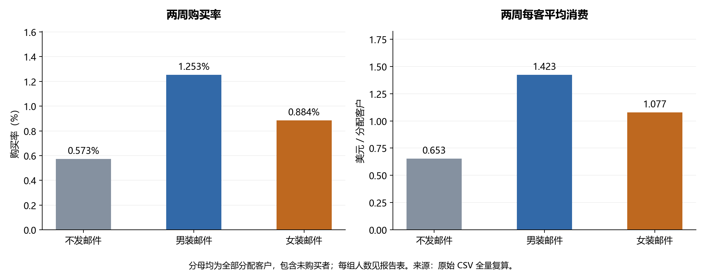

# 零售邮件营销增量评估与客户运营策略分析

基于 Hillstrom 随机实验的内容转化诊断与营销资源配置研究

## 一、执行摘要

本研究聚焦零售企业存量客户的邮件触达效率与营销资源配置，基于 Hillstrom 公开随机实验的64,000条客户记录，围绕“购买转化增量、客户消费贡献、内容策略优先级与经营收益评估”开展分析。研究结果支持继续验证邮件营销的增量价值，并优先配置男装内容的复验资源；规模化推广应以当前业务的对照试验和成本核算为依据。

在购买转化层面，两类内容邮件均带来正向购买增量。不发邮件组的两周购买率为0.573%，男装邮件组和女装邮件组分别为1.253%和0.884%，对应增量为0.681和0.311个百分点。两项经多重比较校正的区间均高于零，说明邮件触达在本次实验中有效促进了历史购买客户再次下单。按同类1,000名客户换算，男装与女装内容分别对应约6.81和3.11名额外购买者，为内容试点的资源排序提供了量化依据。

在客户消费贡献层面，男装与女装邮件的每客平均消费分别较不发邮件增加0.770和0.424美元，购买增量伴随消费贡献同步改善。由于该指标覆盖全部分配客户，其经营意义在于衡量每单位触达规模带来的消费增益，而非仅评价已购客户的客单价。下一步需结合商品毛利、制作发送费用、优惠及退款，判断消费增量能否形成可持续的经营收益。

在内容策略层面，男装邮件相对女装邮件的购买率高0.369个百分点，每客消费高0.345美元，探索性比较呈现一致的优势方向。建议将男装内容列为下一轮优先验证方案，同时保留女装内容与不发邮件组，进一步确认内容优势能否在当前客户与活动条件下复现。邮件名称代表商品内容，不代表收件人的性别。

在落地路径上，建议建立“内容复验—收益核算—客户体验监测—分层策略迭代”的推进机制。用户运营负责内容与目标人群，商业分析负责随机对照及增量评估，财务与客服补充成本、退款和客户反馈；经营负责人依据试点净收益与客户体验表现安排预算。具体实施条件与部门协作建议见第六章。

## 二、研究背景与核心议题

邮件营销的经营价值在于促成客户原本不会发生的购买，而非简单汇总触达后的成交额。面向已有购买经历的存量客户，企业需要同时回答三个问题：邮件能否激活额外购买，不同内容应如何分配资源，以及转化增长是否足以覆盖触达成本。这要求将同期未发送邮件的客户作为参照，剥离自然购买对活动业绩的贡献。

本次实验将过去12个月内购买过商品的客户随机分为男装邮件、女装邮件和不发邮件三组，观察活动后两周的购买与消费表现。报告以这一历史实验为依据，将效果估计转化为内容优先级、预算评估和客户运营试点建议，服务于后续营销决策。

## 三、研究目标与分析框架

### 3.1 核心研究目标

研究围绕三项经营议题展开：第一，触达增量识别，判断两类邮件是否提高历史购买客户的两周购买率；第二，消费贡献评估，衡量每单位触达规模所带来的平均消费增量；第三，内容资源配置，比较男装与女装邮件的效果方向，为下一轮营销试点明确优先顺序。

客户分层是整体评估后的延伸方向。后续可进一步研究距离上次购买时间不同的客户是否存在触达增量差异；本报告尚未完成该项分析，因此当前建议聚焦整体内容试点，不预设具体月份区间的发送规则。

### 3.2 增量评估方法与经营决策框架

本报告构建“实验可信性诊断—购买与消费增量评估—内容优先级判断—经营收益验证”的分析路径。首先检查分组规模与实验前客户特征，为方案比较建立基础；随后分别衡量两类邮件相对不发邮件的转化与消费贡献；最后结合内容直接比较、成本与客户体验，形成营销资源配置建议。

购买率为主指标，每客平均消费为辅助指标。两个邮件对照比较在每个指标内分别控制多重比较，邮件间直接比较标注为探索性。分析方案形成于已看过部分汇总之后，属于回顾性方案，不能视为实验前预注册。

## 四、数据概况与核心业务口径

### 4.1 客户样本与随机实验设计

数据来自 Kevin Hillstrom 发布的 MineThatData 邮件营销实验。发布者说明共有 64,000 名过去 12 个月内购买过商品的客户，按约 1∶1∶1 随机分为男装邮件、女装邮件和不发邮件三组，追踪邮件活动后两周的访问、购买和消费。确切实验起止日期未提供，2008 年是实验说明的发布年份。

| 实验分组 | 发送方案 | 全部分配客户数 |
| --- | --- | --- |
| 不发邮件 | 对照组，不发送活动邮件 | 21,306 |
| 男装邮件 | 发送男装商品内容邮件 | 21,307 |
| 女装邮件 | 发送女装商品内容邮件 | 21,387 |

原文件共有 12 个字段。segment 为原实验分组；conversion 为两周内是否购买；spend 为两周消费金额，单位为美元；visit 为两周内是否访问网站，并非邮件打开或点击。recency 表示距上次购买的月数，history 表示过去一年消费金额；历史品类、渠道、地区和新客标记可用于检查组间特征。

分析按发布者一行一客户处理，保留全部分配记录及未购买者的零金额。来源未提供真实客户 ID、实际送达或阅读记录，估计对象为分配到发送方案的客户，无法单独估计实际阅读邮件者的效果。

### 4.2 营销转化指标与增量评估口径

购买率为两周内购买人数除以该组全部分配客户数；每客平均消费为该组两周消费总额除以全部分配客户数。两者均保留未访问和未购买客户，不按实验后的访问或购买行为筛选分母。每客平均消费与只对购买者计算的客单价不同。

绝对增量为邮件组指标减去对照组指标。购买率差使用百分点，金额差使用美元/分配客户。相对提升为绝对增量除以对照组指标；每千人购买增量为购买率差乘 1,000，是等规模人群的效果换算，并非实际新增客户名单。

主要比较为男装邮件对不发邮件、女装邮件对不发邮件。每个指标内的两项比较采用 Bonferroni 校正，正文展示每项 97.5% 置信区间；两个指标的四项结论未统一作为一个家族控制 5% 错误率，金额结果作为辅助证据。邮件间直接比较使用未校正 95% 区间，属于探索性分析。具体检验和 p 值见附录。

### 4.3 数据质量与经营应用前提

原始 CSV 与两份已有导出逐组对账，人数、购买数、访问数、消费总额及样本标准差一致。另以独立汇总路径核对人数和整数美分总额；CSV 全字段无缺失，二元字段取值有效，购买标记与正消费一致，购买均对应访问。该检查未替代真实 MySQL DDL 或逐行导入验收。

原始记录中有 6,562 条超出首行的全字段相同行，占 10.25%。由于缺少客户 ID，不能直接判断是否重复客户。主分析保留全部记录，避免直接删重选择性减少未购买者。人数比例和历史特征检查见第五章，它们只能提供诊断证据。

数据没有分配日志、行为时间戳或确切实验日期，无法独立审计串组、客户独立性、观察窗口及停止过程；也没有成本、毛利、退订、投诉、退款和长期复购，无法验证利润或护栏。来源未提供事前样本规划、最低业务收益门槛和停止规则，本报告不补写为已设定。

## 五、营销效果诊断与客户运营洞察

本章围绕邮件营销的业务价值逐层展开：先确认方案比较的基础，再分析购买转化与客户消费贡献，最后明确内容策略的验证优先级。各项增量均以同期不发邮件组为参照，避免将自然购买计入营销贡献；统计区间用于说明结果的可靠程度与可变范围。

### 5.1 实验客群结构与组间可比性诊断

按发布者约三等分的说明检查分组人数，卡方诊断 p=0.904，未检出明显人数比例异常。购买间隔、历史消费、历史品类、新客、地区和渠道等已查特征相对不发邮件组的最大绝对标准化差异约为 0.014，未见明显失衡。

上述检查支持在发布者随机实验说明及客户记录独立等假设下进行整体效应估计，但均衡不能证明随机化实施正确。由于缺少客户身份与分流日志，仍需保留原实验无法完整独立审计的限制。

| 分组 | 购买人数 | 两周购买率 | 两周消费总额 美元 | 每客消费 美元 |
| --- | --- | --- | --- | --- |
| 不发邮件 | 122 | 0.573% | 13,908.33 | 0.653 |
| 男装邮件 | 267 | 1.253% | 30,311.69 | 1.423 |
| 女装邮件 | 189 | 0.884% | 23,038.11 | 1.077 |

三组共 578 名购买者，消费总额为 67,258.13 美元。三组人数略有不同，消费总额用于对账，方案效果以购买率及每客消费比较。

### 5.2 邮件触达的购买转化增量

邮件触达在本次实验中促进了存量客户再次购买，其中男装内容呈现更高的转化增量。不发邮件组的两周购买率为0.573%，男装邮件组为1.253%，女装邮件组为0.884%。这一结果为继续开展邮件营销提供了依据，也说明内容配置应同时关注转化水平与相对自然购买的额外贡献。

图1 三组两周购买率对比。来源：Hillstrom 原始数据及项目复算结果；观察期为邮件活动后两周。

| 相比不发邮件 | 购买率差 百分点 | 每项97.5%置信区间 百分点 | 相对提升 | 每千人购买增量 |
| --- | --- | --- | --- | --- |
| 男装邮件 | +0.681 | [0.476, 0.891] | +118.84% | +6.81 |
| 女装邮件 | +0.311 | [0.127, 0.499] | +54.33% | +3.11 |

两项经校正的购买率差区间均高于零，支持两种内容的正向转化贡献。男装邮件的购买率相对提升118.84%，绝对提升为0.681个百分点。由于客户自然购买基准较低，资源评估应以绝对增量及触达规模为主，避免仅凭较大的相对提升率判断经营价值。

图2 两种邮件的购买率增量与置信区间。来源：Hillstrom 原始数据及项目复算结果；观察期为邮件活动后两周。

按同类 1,000 名分配客户换算，男装邮件约增加 6.81 名购买者，每项 97.5% 区间为 [4.76，8.91] 人；女装邮件约增加 3.11 人，区间为 [1.27，4.99] 人。这是对相似条件下效果规模的换算，不能视为新活动一定能实现的新增人数。

### 5.3 客户消费贡献与营销收益空间

购买转化改善同时体现为每单位触达规模的消费贡献提升。男装邮件组的每客平均消费为1.423美元，女装邮件组为1.077美元，不发邮件组为0.653美元。该指标将未购买客户纳入分母，可直接服务于等规模客户触达方案的预算比较。

图3 三组两周每客平均消费对比。来源：Hillstrom 原始数据及项目复算结果；观察期为邮件活动后两周。

| 相比不发邮件 | 每客消费差 美元 | 每项97.5%置信区间 美元 | 相对提升 |
| --- | --- | --- | --- |
| 男装邮件 | +0.770 | [0.444, 1.095] | +117.93% |
| 女装邮件 | +0.424 | [0.132, 0.717] | +65.02% |

两类内容的每客消费增量区间均高于零，说明样本内的转化增长伴随消费贡献增加。按同类1,000名分配客户换算，男装与女装内容分别对应约769.83和424.41美元的两周消费增量。经营决策应在此基础上核算增量毛利与营销投入，明确优惠和退款的计入方式，再判断追加预算的空间。

图4 两种邮件的每客消费增量与置信区间。来源：Hillstrom 原始数据及项目复算结果；观察期为邮件活动后两周。

两张增量图均以零为判断参照，横线表示估计不确定性。图2单位为百分点，图4单位为美元/分配客户，不能按线段长度跨图比较效果大小。两周消费增加也不代表长期复购或客户价值已经改善。

### 5.4 内容效果分化与试点优先级

为了安排内容验证优先级，本报告直接比较男装与女装邮件。男装减女装的购买率差为 0.369 个百分点，未校正 95% 区间为 [0.175，0.566]；每客消费差为 0.345 美元，未校正 95% 区间为 [0.033，0.658]。

两项探索性直接比较均偏向男装内容，建议优先将其纳入下一轮试点，检验优势能否稳定复现。该比较未纳入主要检验家族，适合用于安排验证顺序，不能直接作为全量推广或按客户性别定向发送的依据。

## 六、核心结论与客户运营策略建议

综合购买转化与消费增量，下一阶段的运营重点是优先复验男装内容，并建立以增量净收益和客户体验为依据的扩量机制。以下围绕内容、预算、触达体验与客户分层四项业务议题，明确证据基础、协作职责及试点判断标准。各项分工为建议安排，需结合企业实际组织配置执行。

### 6.1 内容配置提效 优先验证男装邮件的转化优势

【核心发现与策略方向】男装邮件相对不发邮件的购买率增加0.681个百分点，每客消费增加0.770美元，两项校正区间均高于零；与女装内容的探索性比较也呈现优势。建议优先安排男装内容复验，以验证其在当前客户结构和营销活动中的适用性。

【内容试点与实验设计】用户运营选择与研究人群相似、允许接收营销邮件的历史购买客户，商业分析设置男装、女装和不发邮件三组随机对照。统一活动起点与观察窗口，关联分配、送达及购买记录；试验前明确主指标、最低业务增量、样本量和停止规则，按全部分配客户评估。

【推广判断】若当前业务复验达到预定购买增量要求，再结合净收益与客户体验决定扩大范围。若未达到业务门槛，应优先排查内容与客户需求的匹配，调整后继续验证。历史提升率用于制定试点假设，不作为新活动的业绩承诺。

### 6.2 预算配置优化 建立增量毛利与触达成本核算

【收益核算与职责分工】两类邮件均增加每客消费，但消费增长尚不能直接等同于利润。财务与运营需关联商品毛利、邮件制作与发送费用、优惠及退款记录，并按实际推广规模分摊固定投入，形成可比较的单位客户收益账。

【商业评估标准】若可近似使用相同毛利率g，且每名分配客户的增量成本为c，则简化利润增量为g×每客消费增量−c。预算评估应结合消费增量区间，在不同成本与毛利情景下检查收益空间；仅在收益覆盖投入且客户体验符合要求时扩大触达。当前数据未提供g与c，因此不报告实际ROI。

### 6.3 客户体验保障 将负反馈与长期价值纳入推广条件

【触达体验监测】客服与用户运营建立退订、投诉、送达失败、退款或取消的监测口径，明确分母、观察期及可接受的变化幅度。商业分析按原实验分组比较这些结果，将转化收益与客户体验一并提交经营评审。未检出负反馈增加，仍需结合样本量和区间判断证据是否充分。

【频次与长期经营】当购买或消费增加但负反馈超过预设范围时，先调整内容、发送频次或目标客群，再开展验证。同时延长复购与跨期消费观察，区分新增需求和购买时间前移，避免以短期成交透支客户关系。现有两周结果不足以确定长期最优发送频次。

### 6.4 客户分层迭代 以差异化增量验证精准触达策略

【分层研究方向】在整体内容试点基础上，可按实验前的最近购买间隔设置少量业务分组，比较各层邮件相对不发邮件的购买增量，并直接检验层间效果差异。当前仅有578次购买事件，过度细分会削弱估计稳定性；本轮尚不制定具体月份区间的触达规则。

【运营应用原则】客户优先级应依据经过验证的额外购买贡献，而非自然购买率高低。分群结果先形成探索性运营假设，再通过新一轮随机对照确认；不能仅因一组显著、另一组不显著，就认定两组应采用不同触达策略。

## 附录 图表数据来源与统计口径备查

图1与图3 三组购买与消费表现

数据来源为原始 CSV 全量复算及 report_group_summary.csv，并与 experiment_group_summary.csv、experiment_spend_summary.csv 逐组对账。图1采用两周购买率，图3采用两周每客平均消费，分母均为全部分配客户，零金额保留。男装、女装、不发邮件组分别为 21,307、21,387、21,306 人；原始总消费分别为 30,311.69、23,038.11、13,908.33 美元。

图2与图4 邮件对照增量及区间

数据来源为 report_effects.csv。比较方向统一为邮件组减不发邮件组。购买率差采用 Newcombe 方法，基于 Wilson 单比例区间构造；双侧 score 检验启用 correction=True 的小样本方差修正。金额差采用 Welch 均值差区间与双侧检验，不假定组间方差相等；零值多、右偏的金额分布采用大样本近似，未删高值、截尾或只保留购买者。

每个指标内两项比较采用 Bonferroni 校正，单项 alpha=0.05/2=0.025，区间置信度为 97.5%，p 值乘 2、最高为 1。购买率区间和 score 检验构造不同，在边界情况下不保证完全对应，本次方向一致。两个指标的四项结论没有统一作为一个家族控制 5% 错误率。

| 比较方向 | 购买率校正后p值 | 每客消费校正后p值 |
| --- | --- | --- |
| 男装邮件减不发邮件 | 3.048e-13 | 2.328e-07 |
| 女装邮件减不发邮件 | 0.0003143 | 0.002259 |

所有计算使用未舍入结果，正文和图中仅展示舍入值；显示端点相减与显示增量可能相差最后一位。相对提升只报告点估计，未估计相对提升区间。置信区间表示估计方法的不确定性，并非覆盖相应比例的客户，也不代表固定参数具有相应概率。

第5.1节 分组诊断与数据检查

人数诊断以总人数÷3为期望人数，卡方统计量为 0.202531，自由度为 2，p=0.904。标准化差异检查覆盖 recency、history、mens、womens、newbie，以及独热编码后的 zip_code 和 channel；分别比较两种邮件与对照组，差值除以两组样本方差平均值的平方根，最大绝对值约 0.014。细项见 report_baseline_balance.csv。

独立汇总使用标准库 CSV、SQLite 和整数美分；购买率区间另以 Wilson 区间手工组合核对，Welch 汇总统计检验另与原始记录检验对照。数据缺口与处理规则见第4.3节。人数和特征诊断不构成分流实施的独立审计。

第5.4节 邮件直接比较

数据来源为 report_direct_comparison.csv，方向为男装邮件减女装邮件。两项比较采用未校正 95% 区间，购买率 p=0.0002052，每客消费 p=0.03047，均为探索性结果。原实验最小可检测效应、事前功效、规划时长和停止规则未知；没有用观察到的显著性倒推样本充足。

数据发布来源与复现入口

原始发布说明为 Kevin Hillstrom 的 MineThatData E-Mail Analytics And Data Mining Challenge，发布日期为 2008 年 3 月 20 日。来源页面：https://blog.minethatdata.com/2008/03/minethatdata-e-mail-analytics-and-data.html 。实验人群、随机分组和两周窗口依据发布者说明；此前页面快照已保存在本地，本次数据版本未更换。

原始数据文件为 Kevin_Hillstrom_MineThatData_E-MailAnalytics_DataMiningChallenge_2008.03.20.csv，SHA-256 为 0e5893329d8b93cefecc571777672028290ab69865718020c78c7284f291aece。原始文件保留本地，来源尚未确认明确标准数据许可，再分发前需核实。

项目结果位于 data/analysis_output；总体复算脚本为 python/03_build_report.py，报告核对记录为 report_validation.json。统计方法参考 statsmodels 两独立比例区间官方文档：https://www.statsmodels.org/stable/generated/statsmodels.stats.proportion.confint_proportions_2indep.html 。本项目为公开历史随机实验复盘，不代表亲自实施了线上实验或已为实际企业创造收益。
