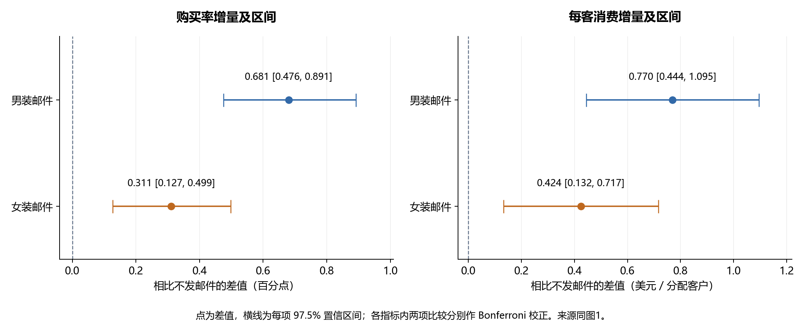

# 邮件营销 AB 试验数据分析报告

Hillstrom 客户营销研究  活动后两周观察  复盘日期 2026 年 11 月 4 日

> 网页版保留完整双面板原图；Word 中展示对应的单面板裁剪。

## 一、总结简报

零售企业可优先复验男装内容邮件，并以额外购买、每客消费和客户负反馈共同决定是否扩大触达。本报告基于 Hillstrom 公开随机实验的 64,000 条客户记录，比较男装邮件、女装邮件和不发邮件三种方案，评估活动后两周的购买与消费增量。该项目为历史实验复盘。

购买转化方面，两种邮件相对不发邮件均有正向增量。不发邮件组购买率为 0.573%，男装邮件组为 1.253%，增加 0.681 个百分点；女装邮件组为 0.884%，增加 0.311 个百分点。经各指标内两项比较的 Bonferroni 校正，每项 97.5% 置信区间分别为 [0.476，0.891] 和 [0.127，0.499] 个百分点，均高于零。

每客消费方面，不发邮件组为 0.653 美元，男装邮件组为 1.423 美元，女装邮件组为 1.077 美元；两种邮件分别增加 0.770 美元和 0.424 美元。对应区间均高于零，但数据缺少毛利、营销成本及退款，尚不能判断消费增长能否转化为净收益。

内容选择方面，男装邮件的购买增量点估计更大。两种邮件的探索性直接比较中，购买率差为 0.369 个百分点，每客消费差为 0.345 美元，未校正 95% 区间均高于零。该结果可用于安排复验优先级，仍需在当前业务中按事先固定的比较方案确认。

后续可由用户运营团队组织邮件方案与触达人群，数据团队负责随机分组、统一口径和效果评估，财务及客户服务团队补充成本、退款和负反馈记录。这些属于建议分工；仅在增量收益覆盖成本、护栏满足预定要求时扩大触达。具体方案见第六章。

## 二、分析背景

邮件活动结束后产生的购买，既可能来自邮件触达，也可能来自客户原本就会发生的购买。因此，评价邮件价值需要与同期不发邮件的客户比较，估计发送方案带来的额外购买和消费，而不能直接把邮件组的全部消费视为活动贡献。

本实验将过去 12 个月内购买过商品的客户随机分成三组，提供了比较发送方案的依据。男装和女装代表邮件展示的商品内容，并非客户性别。本报告据此回答是否值得继续验证邮件触达、哪种内容应优先投入，以及扩量前还需补充哪些经营证据。

## 三、分析目标与框架

### 3.1 分析目标

已确认的业务问题为：针对过去12个月内购买过商品的客户，评估男装邮件和女装邮件相比不发邮件，是否提高随后两周的购买率和每客平均消费金额；比较两种邮件的购买效果是否存在差异，并探索邮件带来的购买增量是否因客户距离上次购买的时间不同而变化，为后续邮件触达策略提供依据。

本报告完成整体购买与消费增量评估，并补充两种内容的探索性直接比较。最近购买间隔的异质性分析尚未完成，现有结论不支持按具体月份区间设定发送规则。

### 3.2 分析框架

先检查数据范围、分组人数、实验前特征与记录逻辑，判断比较的可信程度；再分别计算两种邮件相对不发邮件的购买率差和每客消费差，结合区间评估方向与大小；最后用两种邮件的直接比较安排后续验证，并结合成本、护栏和长期效果确定扩量条件。

购买率为主指标，每客平均消费为辅助指标。两个邮件对照比较在每个指标内分别控制多重比较，邮件间直接比较标注为探索性。分析方案形成于已看过部分汇总之后，属于回顾性方案，不能视为实验前预注册。

## 四、数据释义

### 4.1 数据范围与实验分组

数据来自 Kevin Hillstrom 发布的 MineThatData 邮件营销实验。发布者说明共有 64,000 名过去 12 个月内购买过商品的客户，按约 1∶1∶1 随机分为男装邮件、女装邮件和不发邮件三组，追踪邮件活动后两周的访问、购买和消费。确切实验起止日期未提供，2008 年是实验说明的发布年份。

| 实验分组 | 发送方案 | 全部分配客户数 |
|---|---|---:|
| 不发邮件 | 对照组，不发送活动邮件 | 21,306 |
| 男装邮件 | 发送男装商品内容邮件 | 21,307 |
| 女装邮件 | 发送女装商品内容邮件 | 21,387 |

原文件共有 12 个字段。segment 为原实验分组；conversion 为两周内是否购买；spend 为两周消费金额，单位为美元；visit 为两周内是否访问网站，并非邮件打开或点击。recency 表示距上次购买的月数，history 表示过去一年消费金额；历史品类、渠道、地区和新客标记可用于检查组间特征。

分析按发布者一行一客户处理，保留全部分配记录及未购买者的零金额。来源未提供真实客户 ID、实际送达或阅读记录，估计对象为分配到发送方案的客户，无法单独估计实际阅读邮件者的效果。

### 4.2 指标口径与比较规则

购买率为两周内购买人数除以该组全部分配客户数；每客平均消费为该组两周消费总额除以全部分配客户数。两者均保留未访问和未购买客户，不按实验后的访问或购买行为筛选分母。每客平均消费与只对购买者计算的客单价不同。

绝对增量为邮件组指标减去对照组指标。购买率差使用百分点，金额差使用美元/分配客户。相对提升为绝对增量除以对照组指标；每千人购买增量为购买率差乘 1,000，是等规模人群的效果换算，并非实际新增客户名单。

主要比较为男装邮件对不发邮件、女装邮件对不发邮件。每个指标内的两项比较采用 Bonferroni 校正，正文展示每项 97.5% 置信区间；两个指标的四项结论未统一作为一个家族控制 5% 错误率，金额结果作为辅助证据。邮件间直接比较使用未校正 95% 区间，属于探索性分析。具体检验和 p 值见附录。

### 4.3 数据复核与解释边界

原始 CSV 与两份已有导出逐组对账，人数、购买数、访问数、消费总额及样本标准差一致。另以独立汇总路径核对人数和整数美分总额；CSV 全字段无缺失，二元字段取值有效，购买标记与正消费一致，购买均对应访问。该检查未替代真实 MySQL DDL 或逐行导入验收。

原始记录中有 6,562 条超出首行的全字段相同行，占 10.25%。由于缺少客户 ID，不能直接判断是否重复客户。主分析保留全部记录，避免直接删重选择性减少未购买者。人数比例和历史特征检查见第五章，它们只能提供诊断证据。

数据没有分配日志、行为时间戳或确切实验日期，无法独立审计串组、客户独立性、观察窗口及停止过程；也没有成本、毛利、退订、投诉、退款和长期复购，无法验证利润或护栏。来源未提供事前样本规划、最低业务收益门槛和停止规则，本报告不补写为已设定。

## 五、分析内容

本章先说明实验比较的可信程度，再回答邮件是否增加购买、每客消费是否同步改善，以及两种内容之间的差异。所有展示数值均由未舍入结果计算，表格与图表只在显示时保留相应小数。

### 5.1 实验分组与数据可信性

按发布者约三等分的说明检查分组人数，卡方诊断 p=0.904，未检出明显人数比例异常。购买间隔、历史消费、历史品类、新客、地区和渠道等已查特征相对不发邮件组的最大绝对标准化差异约为 0.014，未见明显失衡。

上述检查支持在发布者随机实验说明及客户记录独立等假设下进行整体效应估计，但均衡不能证明随机化实施正确。由于缺少客户身份与分流日志，仍需保留原实验无法完整独立审计的限制。

| 分组 | 购买人数 | 两周购买率 | 两周消费总额 美元 | 每客消费 美元 |
|---|---:|---:|---:|---:|
| 不发邮件 | 122 | 0.573% | 13,908.33 | 0.653 |
| 男装邮件 | 267 | 1.253% | 30,311.69 | 1.423 |
| 女装邮件 | 189 | 0.884% | 23,038.11 | 1.077 |

三组共 578 名购买者，消费总额为 67,258.13 美元。三组人数略有不同，消费总额用于对账，方案效果以购买率及每客消费比较。

### 5.2 购买率及购买增量

两种邮件均提高了样本内的两周购买率，男装邮件的增量点估计更大。不发邮件组购买率为 0.573%，男装邮件组为 1.253%，女装邮件组为 0.884%。运营团队可据此继续验证邮件触达，同时保留不发邮件组，避免把客户自然购买误算为活动贡献。

| 相比不发邮件 | 购买率差 百分点 | 每项97.5%置信区间 百分点 | 相对提升 | 每千人购买增量 |
|---|---:|---:|---:|---:|
| 男装邮件 | +0.681 | [0.476, 0.891] | +118.84% | +6.81 |
| 女装邮件 | +0.311 | [0.127, 0.499] | +54.33% | +3.11 |

两项校正区间均高于零，支持两种邮件带来额外购买。男装邮件相对提升 118.84%，对应的绝对提升是 0.681 个百分点；低基准会使相对提升看起来较大，业务判断应同时看绝对增量。

按同类 1,000 名分配客户换算，男装邮件约增加 6.81 名购买者，每项 97.5% 区间为 [4.76，8.91] 人；女装邮件约增加 3.11 人，区间为 [1.27，4.99] 人。这是对相似条件下效果规模的换算，不能视为新活动一定能实现的新增人数。

### 5.3 每客消费及消费增量

邮件组的每客消费也高于不发邮件组。男装邮件组为 1.423 美元，女装邮件组为 1.077 美元，不发邮件组为 0.653 美元。该指标保留未购买者，反映全部分配客户的平均消费表现。

| 相比不发邮件 | 每客消费差 美元 | 每项97.5%置信区间 美元 | 相对提升 |
|---|---:|---:|---:|
| 男装邮件 | +0.770 | [0.444, 1.095] | +117.93% |
| 女装邮件 | +0.424 | [0.132, 0.717] | +65.02% |

两种邮件的消费差区间均高于零。按同类 1,000 名分配客户换算，男装邮件对应约 769.83 美元、女装邮件对应约 424.41 美元的两周消费增量。财务评估应进一步扣除相关成本，并明确优惠和退款的计入方式，才能判断是否值得追加预算。

两张增量图均以零为判断参照，横线表示估计不确定性。图2单位为百分点，图4单位为美元/分配客户，不能按线段长度跨图比较效果大小。两周消费增加也不代表长期复购或客户价值已经改善。

### 5.4 两种邮件内容的探索性比较

为了安排内容验证优先级，本报告直接比较男装与女装邮件。男装减女装的购买率差为 0.369 个百分点，未校正 95% 区间为 [0.175，0.566]；每客消费差为 0.345 美元，未校正 95% 区间为 [0.033，0.658]。

两项直接比较的区间均高于零，方向偏向男装内容，但未纳入主要比较家族。现有证据支持优先复验男装邮件，尚不能确定它对所有客户或后续活动都更好。内容选择不能仅凭两组各自相对对照显著，也不能把男装内容的优势解释为只应向男性客户发送。

## 六、核心结论与建议

后续应以额外购买和经营净收益作为邮件触达的评估重点。用户运营团队可牵头安排内容与人群，数据团队负责实验设计和分析，财务及客户服务团队补足成本与护栏。以下为建议分工和下一轮试验条件，并非原历史活动已实施的安排。

### 6.1 优先复验男装内容并保留不发邮件组

男装邮件相对不发邮件的购买率增加 0.681 个百分点，每客消费增加 0.770 美元，两项校正区间均高于零；与女装邮件的探索性直接比较也偏向男装内容，因此可优先安排复验资源。

用户运营团队可在当前业务中选择与研究人群相似、允许接收营销邮件的历史购买客户，由数据团队随机设置男装、女装和不发邮件三组。三组采用相同活动起点和完整观察窗口，记录分配、送达和后续行为。运行前固定主指标、最小有业务意义增量、样本量、比较家族和停止规则，按全部分配客户评估，避免仅分析打开或购买的人。

若当前业务的复验仍显示购买增量为正，再结合成本与护栏评估是否扩大；如购买没有达到预定业务收益要求，应先检查内容与人群匹配，不把历史样本的提升率直接作为新活动承诺。

### 6.2 补齐成本后决定是否增加预算

两种邮件带来正向每客消费增量，但当前无法判断利润。财务与运营应记录邮件制作、发送、优惠等增量成本，关联商品毛利和退款，并将固定成本按实际决策规模合理分摊。

若可近似使用相同毛利率 g，且每名分配客户的增量成本为 c，简化利润增量为 g×每客消费增量−c。该式只是判断框架；数据没有提供 g 和 c，无法计算真实 ROI 或盈亏平衡成本数值。预算评估应同时考虑增量估计的区间，避免仅凭有利的点估计扩量。

### 6.3 将客户负反馈和长期结果纳入扩量条件

客户服务与用户运营应补充退订、投诉、送达失败、退款或取消记录，明确各项指标的分母、观察期、可接受恶化幅度与判断方式。数据团队应按相同分组评估这些护栏，不能把没有检出恶化直接解释为已经证明安全。

当购买或消费增加但退订、投诉超出预设容忍范围时，应调整内容、频次或人群后再试验。长期复购和跨期消费也应继续跟踪，以区分新增需求与购买时间前移。现有数据只有两周结果，不能据此提高长期发送频次。

### 6.4 分群策略以增量差异验证为依据

当前报告没有完成最近购买间隔的效果差异分析。后续可围绕实验前的 recency 设定少量有业务含义的分组，比较邮件相对不发邮件的购买增量，并直接检验分组间的效果差异。总购买事件仅 578 次，切分过细会使估计不稳定。

运营应根据经过验证的增量安排触达，而不是仅向原本购买率高的客户发送；也不能因一组显著、另一组不显著就认定两组效果不同。分群结果先作为探索性证据，再通过新一轮对照试验确认。

## 附录 图表数据来源与统计说明

### 图1与图3 三组购买与消费表现

数据来源为原始 CSV 全量复算及 report_group_summary.csv，并与 experiment_group_summary.csv、experiment_spend_summary.csv 逐组对账。图1采用两周购买率，图3采用两周每客平均消费，分母均为全部分配客户，零金额保留。男装、女装、不发邮件组分别为 21,307、21,387、21,306 人；原始总消费分别为 30,311.69、23,038.11、13,908.33 美元。

### 图2与图4 邮件对照增量及区间

数据来源为 report_effects.csv。比较方向统一为邮件组减不发邮件组。购买率差采用 Newcombe 方法，基于 Wilson 单比例区间构造；双侧 score 检验启用 correction=True 的小样本方差修正。金额差采用 Welch 均值差区间与双侧检验，不假定组间方差相等；零值多、右偏的金额分布采用大样本近似，未删高值、截尾或只保留购买者。

每个指标内两项比较采用 Bonferroni 校正，单项 alpha=0.05/2=0.025，区间置信度为 97.5%，p 值乘 2、最高为 1。购买率区间和 score 检验构造不同，在边界情况下不保证完全对应，本次方向一致。两个指标的四项结论没有统一作为一个家族控制 5% 错误率。

| 比较方向 | 购买率校正后p值 | 每客消费校正后p值 |
|---|---:|---:|
| 男装邮件减不发邮件 | 3.048e-13 | 2.328e-07 |
| 女装邮件减不发邮件 | 0.0003143 | 0.002259 |

所有计算使用未舍入结果，正文和图中仅展示舍入值；显示端点相减与显示增量可能相差最后一位。相对提升只报告点估计，未估计相对提升区间。置信区间表示估计方法的不确定性，并非覆盖相应比例的客户，也不代表固定参数具有相应概率。

### 第5.1节 分组诊断与数据检查

人数诊断以总人数÷3为期望人数，卡方统计量为 0.202531，自由度为 2，p=0.904。标准化差异检查覆盖 recency、history、mens、womens、newbie，以及独热编码后的 zip_code 和 channel；分别比较两种邮件与对照组，差值除以两组样本方差平均值的平方根，最大绝对值约 0.014。细项见 report_baseline_balance.csv。

独立汇总使用标准库 CSV、SQLite 和整数美分；购买率区间另以 Wilson 区间手工组合核对，Welch 汇总统计检验另与原始记录检验对照。数据缺口与处理规则见第4.3节。人数和特征诊断不构成分流实施的独立审计。

### 第5.4节 邮件直接比较

数据来源为 report_direct_comparison.csv，方向为男装邮件减女装邮件。两项比较采用未校正 95% 区间，购买率 p=0.0002052，每客消费 p=0.03047，均为探索性结果。原实验最小可检测效应、事前功效、规划时长和停止规则未知；没有用观察到的显著性倒推样本充足。

### 数据发布来源与复现入口

原始发布说明为 Kevin Hillstrom 的 MineThatData E-Mail Analytics And Data Mining Challenge，发布日期为 2008 年 3 月 20 日。来源页面：https://blog.minethatdata.com/2008/03/minethatdata-e-mail-analytics-and-data.html 。实验人群、随机分组和两周窗口依据发布者说明；此前页面快照已保存在本地，本次数据版本未更换。

原始数据文件为 Kevin_Hillstrom_MineThatData_E-MailAnalytics_DataMiningChallenge_2008.03.20.csv，SHA-256 为 0e5893329d8b93cefecc571777672028290ab69865718020c78c7284f291aece。原始文件保留本地，来源尚未确认明确标准数据许可，再分发前需核实。

项目结果位于 data/analysis_output；总体复算脚本为 python/03_build_report.py，报告核对记录为 report_validation.json。统计方法参考 statsmodels 两独立比例区间官方文档：https://www.statsmodels.org/stable/generated/statsmodels.stats.proportion.confint_proportions_2indep.html 。本项目为公开历史随机实验复盘，不代表亲自实施了线上实验或已为实际企业创造收益。
